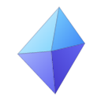

# Shard

English | [中文](README.zh-CN.md)

A lightweight personal screenshot tool for Windows: capture, annotate, pin, and recognize text. Minimal UI, fast to open, and OCR runs on the engine built into Windows, so it works offline and adds nothing to the installer size.

## Features

- **Capture**: press `Alt+A` and drag out a region. Move the selection, or drag its corners and edges to resize. Works across multiple monitors and captures in physical pixels, so it stays sharp on high-DPI screens.
- **Annotate**: spotlight (dims the rest of the selection), arrow, pen, text, and mosaic, with undo.
- **Copy**: press `Enter`, double-click the selection, or click ✓ to copy the image (written as both DIB and PNG, so it pastes into WeChat, Office, and browsers).
- **Pin**: pin the selection to the desktop, always on top and draggable. A pinned image is OCR'd in the background with no visible boxes; just drag across the text to select and copy it.
- **Recognize text**: click the OCR button while capturing. The text is laid over the image as a transparent layer you can select and copy, or copy all at once.
- **Save**: save as a PNG file.

## Shortcuts

| Where | Keys | Action |
|---|---|---|
| Global | `Alt+A` | Capture |
| Capture | `Enter` / double-click selection | Copy and close |
| Capture | `Ctrl+Z` | Undo |
| Capture | `Ctrl+C` | Copy selected OCR text, or the image if no text is selected |
| Capture | Right-click | Clear the selection, or exit if there is none |
| Capture | `Esc` | Exit |
| Pin | Drag | Move |
| Pin | Double-click / `Esc` | Close |
| Pin | `Ctrl+C` | Copy selected text, or the image if no text is selected |
| Pin | Right-click | Menu: copy image, copy all text, save, close |

`Alt+A` is also WeChat's screenshot shortcut, and tools like PixPin may take it too. If registration fails, Shard shows a warning; change the shortcut in the other app. Until then, click the tray icon to capture.

## Tech stack

| Layer | Choice |
|---|---|
| Shell | [Tauri v2](https://tauri.app) |
| Frontend | React 19, TypeScript, Tailwind CSS 4, Vite (no component or state libraries) |
| Capture | GDI `BitBlt` writes straight into a WebView2 SharedBuffer; the frontend turns it into a bitmap with `VideoFrame`, with no IPC copy |
| Annotation | Canvas 2D; shapes are kept as a vector list and composited at physical resolution on export |
| OCR | `Windows.Media.Ocr` (built into Windows, offline) |
| System | `windows` crate: Win32 clipboard, DWM (cloaked show, disabled window animations, corners) |
| Shared types | ts-rs generates TypeScript types from Rust types |
| Packaging | NSIS installer, per-user install |

Windows 10/11 only. OCR languages depend on which recognizer language packs are installed (the Chinese recognizer also reads English and digits).

## Development

Requires Rust (MSVC toolchain), Visual Studio Build Tools ("Desktop development with C++"), Node.js, and pnpm.

```bash
pnpm install
```

```bash
pnpm tauri dev
```

Build the installer at `src-tauri/target/release/bundle/nsis/Shard_<version>_x64-setup.exe`:

```bash
pnpm tauri build
```

Rust unit tests (also regenerate the TS types under `src/lib/bindings/`):

```bash
cd src-tauri && cargo test
```
